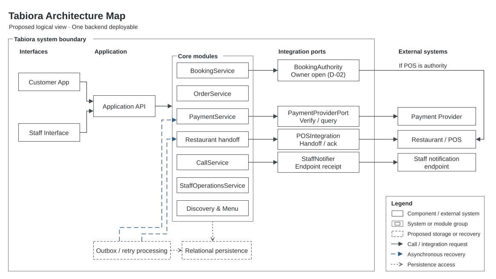

# Tabiora Architecture Map

Status **Proposed logical design**. The Customer App and Staff Interface use the Application API to reach Tabiora's logical modules. Booking, payment, waiter calls, and restaurant handoff use ports to reach their respective authorities or recipients. The pilot proposes one backend deployable for the API, modules, and adapters. Dashed purple arrows show candidate recovery invoking the same payment and handoff logic. [Deployment & Operational View](deployment-operational-view.md#why-a-modular-monolith-for-the-pilot) · [Editable Lab 10 map](https://drive.google.com/file/d/1uazruv4TbqWrvL1MU_owLgO34Xjf3RWy/view)

[Editable draw.io source](../../assets/diagrams/source/dineflow-architecture-map.drawio) · [Full-size SVG](../../assets/diagrams/dineflow-architecture-map.svg)

For print, place the SVG at full content width on a landscape page to retain readable labels and line patterns.

## State ownership

| State or record | Owner and boundary | Traceability |
| --- | --- | --- |
| Reservation | One coordinated authority determines whether a table and interval can be committed. Tabiora or Restaurant/POS may fulfil `BookingAuthority` under D-02. An overlap returns `CONFLICT`, invalid input returns `INVALID`, and an unobtainable authoritative result returns `SOURCE_UNAVAILABLE`. Only authoritative evidence establishes `CONFIRMED`. | FR-004–FR-005, NFR-004, AC-001, AC-004–AC-005, [ADR-001](adr/adr-001-authoritative-booking.md) |
| `Payment` and `PreOrder` | The Payment Provider is the source of verifiable financial outcomes. Tabiora tracks payment attempts and evaluates pre-order and visit eligibility. The restaurant bill follows UC-06 and its source remains open under D-05. | FR-007–FR-008, FR-011, NFR-005, NFR-008, AC-002, [ADR-002](adr/adr-002-verified-payment-and-restaurant-handoff.md) |
| `DeliveryStatus` | Tabiora tracks restaurant handoff separately. Agreed Restaurant/POS acknowledgement establishes `DELIVERED`. D-06 governs acknowledgement and recovery. | FR-009, AC-005–AC-006, P-INTEGRATION, [ADR-002](adr/adr-002-verified-payment-and-restaurant-handoff.md) |
| `WaiterCall` | Tabiora retains the call. Endpoint receipt establishes `NOTIFIED` under P-CALL. An authorized waiter in that restaurant establishes `ACKNOWLEDGED`. Routing and escalation remain open under D-07. | FR-010, FR-014, NFR-002, NFR-006, AC-004 |

Relational persistence is proposed for Tabiora-owned records. Booking writes depend on D-02. The candidate outbox and retry processing represent recoverable dispatch and status queries with stable references. Partner capabilities, acknowledgement behavior, and availability require verification. [Architecture Baseline v1.0](architecture-baseline.md) · [Proposed lifecycle model](../requirements/functional-requirements.md#proposed-lifecycle-model)
