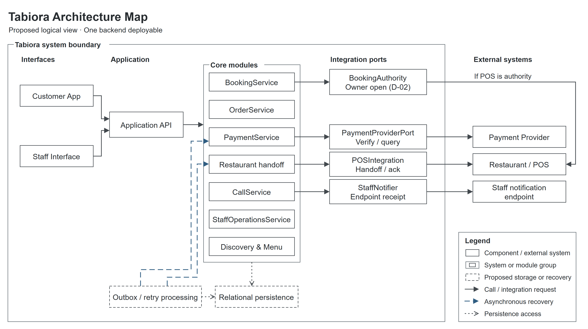

# Tabiora Architecture Map

**Proposed logical design.** The pilot groups the API, core modules, and integration adapters in one backend deployable. [Deployment & Operational View](deployment-operational-view.md#why-a-modular-monolith-for-the-pilot) · [Editable Lab 10 map](https://drive.google.com/file/d/1uazruv4TbqWrvL1MU_owLgO34Xjf3RWy/view)

[Editable draw.io source](../../assets/diagrams/architecture-map/architecture-map.drawio) · [Full-size PNG](../../assets/diagrams/architecture-map/architecture-map.png)

Print the PNG at full content width on a landscape page.

Solid arrows show calls and integration requests. Dashed arrows show proposed payment reconciliation and handoff recovery. Dotted arrows show persistence access.

Traceability: smartphone access (AC-003), staff operations (FR-012–FR-014, NFR-006, AC-004), discovery and menu (FR-001–FR-004, FR-006), and operation records (NFR-008).

## State ownership

| State or record | Owner and boundary | Traceability |
| --- | --- | --- |
| Reservation | One coordinated authority determines whether a table and interval can be committed. Tabiora or Restaurant/POS may fulfil `BookingAuthority` under D-02. An overlap returns `CONFLICT`, invalid input returns `INVALID`, and an unobtainable authoritative result returns `SOURCE_UNAVAILABLE`. Only authoritative evidence establishes `CONFIRMED`. | FR-004–FR-005, NFR-004, AC-001, AC-004–AC-005, [ADR-001](adr/adr-001-authoritative-booking.md) |
| `Payment` and `PreOrder` | The Payment Provider is the source of verifiable financial outcomes. Tabiora tracks payment attempts and evaluates pre-order and visit eligibility. The restaurant bill follows UC-06 and its source remains open under D-05. | FR-007–FR-008, FR-011, NFR-005, NFR-008, AC-002, [ADR-002](adr/adr-002-verified-payment-and-restaurant-handoff.md) |
| `DeliveryStatus` | Tabiora tracks restaurant handoff separately. Agreed Restaurant/POS acknowledgement establishes `DELIVERED`. D-06 governs acknowledgement and recovery. | FR-009, AC-005–AC-006, P-INTEGRATION, [ADR-002](adr/adr-002-verified-payment-and-restaurant-handoff.md) |
| `WaiterCall` | Tabiora retains the call. Endpoint receipt establishes `NOTIFIED` under P-CALL. An authorized waiter in that restaurant establishes `ACKNOWLEDGED`. Routing and escalation remain open under D-07. | FR-010, FR-014, NFR-002, NFR-006, AC-004 |

Proposed persistence stores Tabiora-owned records, including booking writes only if D-02 assigns authority to Tabiora. Handoff starts from confirmed reservations or eligible paid pre-orders. Candidate recovery reuses stable references. Partner capabilities and acknowledgement contracts require verification. [Architecture Baseline v1.0](architecture-baseline.md) · [Proposed lifecycle model](../requirements/functional-requirements.md#proposed-lifecycle-model)
