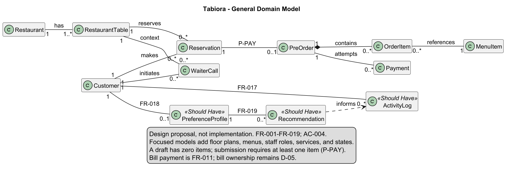
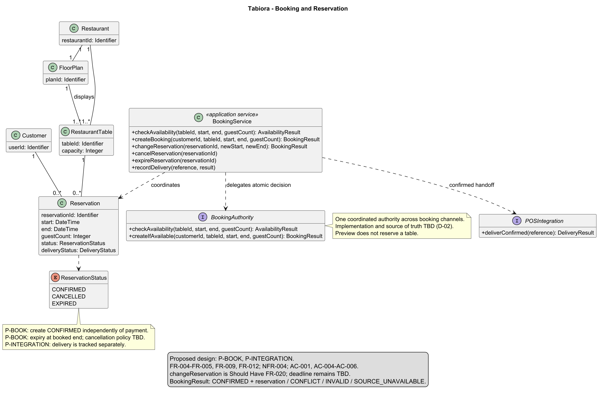
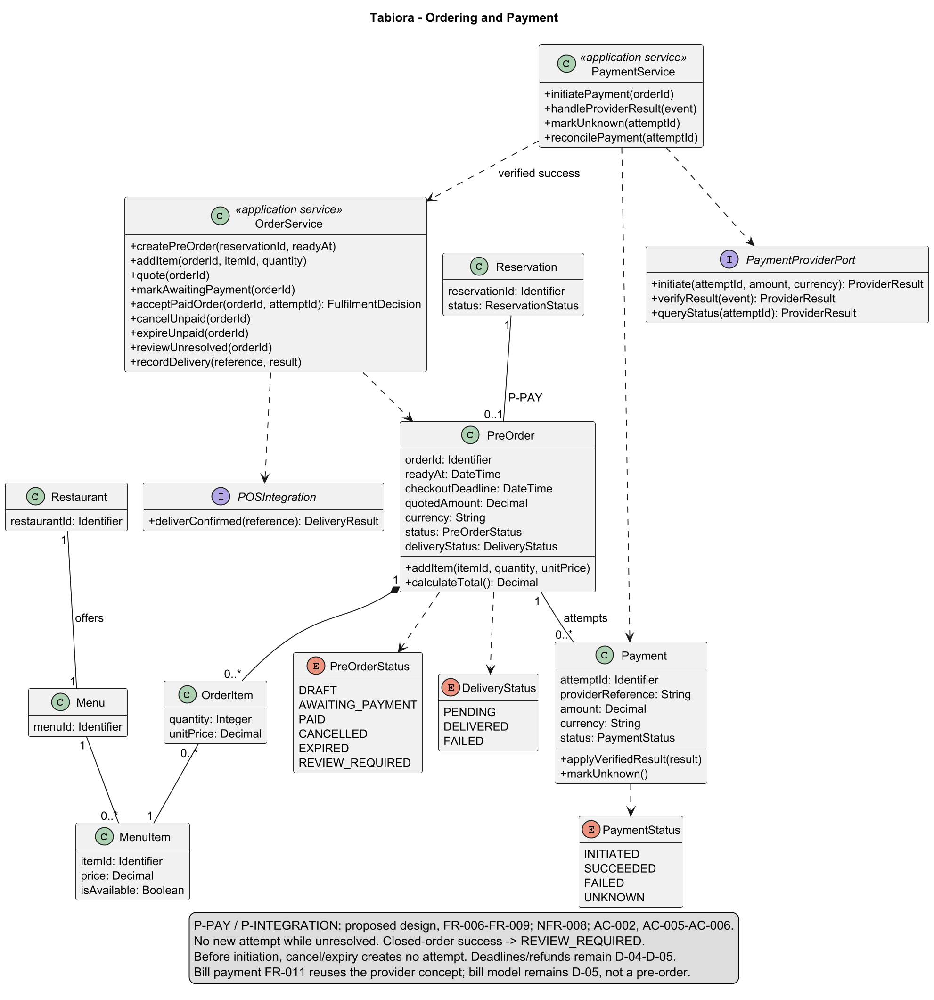
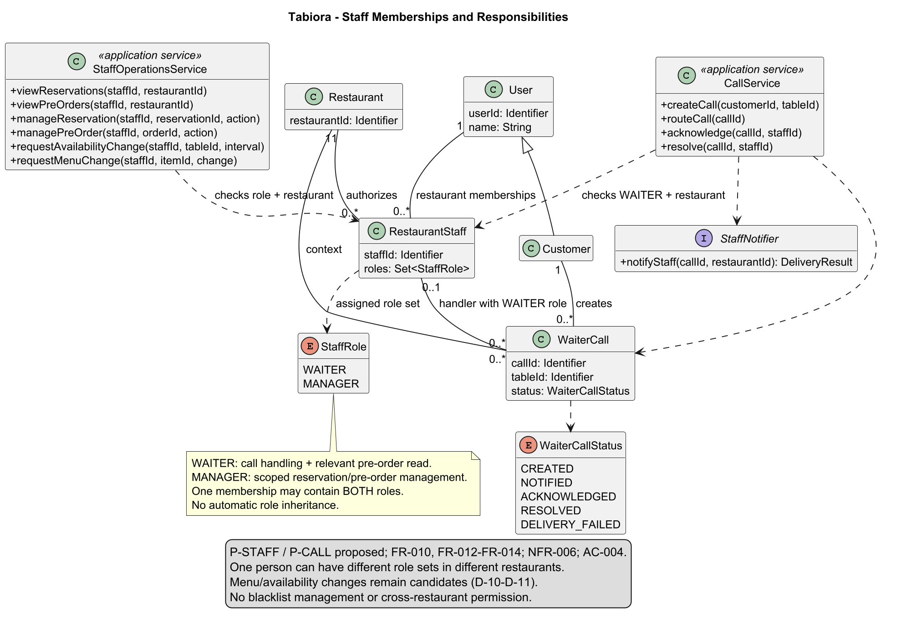

# Class Models

**Proposed logical models.** See the [lifecycle model](../requirements/functional-requirements.md#proposed-lifecycle-model) for state definitions.

## How the top-down design was derived

The core workflows in FR-001–FR-014 determine the domain objects and which responsibilities need separate lifecycles.

| High-level concept | Decomposition | Reason for the classes/relationships | Supported workflow |
| --- | --- | --- | --- |
| Restaurant and seating | Restaurant, FloorPlan, RestaurantTable, Reservation | A floor plan displays tables; a reservation links a customer and one table to an interval. Table identity/capacity is separate from time-dependent availability. Ordinary associations avoid inventing deletion ownership. | UC-01 discovery; UC-02 atomic booking |
| Planned food and payment | PreOrder, OrderItem, MenuItem, Payment | Items belong to one draft/order, so composition is appropriate. MenuItem remains a referenced product; OrderItem snapshots its quoted price. Payment is an attempt with a provider outcome, not the order itself. | UC-03 draft, checkout exit, payment and late-result handling |
| Restaurant service | User, RestaurantStaff membership, StaffRole, WaiterCall | A person can have a different set of responsibilities in each restaurant. WAITER and MANAGER roles are data on that membership, not employee subclasses that imply inherited permissions. A call has its own receipt/acknowledgement/resolution lifecycle. | UC-04 call handling; UC-05 staff operations |
| Later personalization | ActivityLog, PreferenceProfile, Recommendation | Recorded activity, derived preferences and suggested choices are different facts. They remain Should Have concepts, not extra core booking dependencies. | UC-08, FR-017–FR-019 |

BookingService, OrderService, PaymentService, and CallService coordinate those workflows. Operations match the [sequence diagrams](sequence-diagram.md). Ports isolate the authoritative booking decision, provider result, restaurant acknowledgement, and notification receipt.

## General domain model

[Full-size PNG](../../assets/diagrams/domain-class-diagram/domain-class-diagram.png) · [PlantUML](../../assets/diagrams/domain-class-diagram/domain-class-diagram.puml)

The overview shows visit entities and their relationships. Focused views add attributes and operations. Multiplicities follow the proposals, including one pre-order per reservation under P-PAY.

## Booking and reservation

[Full-size PNG](../../assets/diagrams/booking-class-diagram/booking-class-diagram.png) · [PlantUML](../../assets/diagrams/booking-class-diagram/booking-class-diagram.puml)

Customer–Reservation and FloorPlan–RestaurantTable are ordinary associations. Availability depends on the requested interval and authoritative reservations. Capacity is a validation input.

BookingService coordinates previews, creation, changes, and delivery recording. BookingAuthority owns the atomic decision under [ADR-001](adr/adr-001-authoritative-booking.md). The proposed `changeReservation` supports FR-020, with contract and deadlines open in D-03. Reservation and handoff use separate [lifecycles](../requirements/functional-requirements.md#proposed-lifecycle-model).

**Traceability:** FR-004–FR-005, FR-009, FR-012, FR-020; NFR-004; AC-001, AC-004–AC-006.

## Ordering and payment

[Full-size PNG](../../assets/diagrams/ordering-class-diagram/ordering-class-diagram.png) · [PlantUML](../../assets/diagrams/ordering-class-diagram/ordering-class-diagram.puml)

PreOrder owns OrderItems by composition. Drafts may be empty. Submission requires a valid item under P-PAY. An OrderItem references MenuItem and snapshots its quoted unit price. Menu–MenuItem remains an ordinary association.

OrderService validates items, quotes, tracks order state, and coordinates handoff through POSIntegration. PaymentService manages attempts, verification, and reconciliation through PaymentProviderPort. Payment records an attempt. [ADR-002](adr/adr-002-verified-payment-and-restaurant-handoff.md) covers eligibility and late results. [UC-06](../requirements/use-cases.md#uc-06--pay-the-restaurant-bill) covers the separate bill.

**Traceability:** FR-006–FR-009; FR-011 integration concept only; NFR-005, NFR-008; AC-002, AC-005–AC-006.

## Restaurant staff and operations

[Full-size PNG](../../assets/diagrams/staff-class-diagram/staff-class-diagram.png) · [PlantUML](../../assets/diagrams/staff-class-diagram/staff-class-diagram.puml)

Customer specializes User. RestaurantStaff links a person to a restaurant and its assigned StaffRole set. WAITER and MANAGER are roles on the membership. The [permission matrix](../requirements/functional-requirements.md#proposed-staff-permissions) defines their scopes and candidate actions.

CallService coordinates call creation, routing, acknowledgement, and resolution. StaffNotifier reports endpoint receipt or failure. StaffOperationsService checks restaurant membership and role before applying management actions. Exact transitions remain open in D-11.

**Traceability:** FR-010, FR-012–FR-014, FR-027; NFR-002, NFR-006; AC-004.

## Contract and result interpretation

Identifier and DateTime are logical types. Protocol and error formats remain TBD.

| Result | Meaning |
| --- | --- |
| AvailabilityResult | Table available or unavailable, `INVALID` input, or `SOURCE_UNAVAILABLE` when the authoritative preview cannot be obtained. |
| BookingResult | `CONFIRMED` with a reservation reference, `CONFLICT`, `INVALID`, or `SOURCE_UNAVAILABLE`. See [ADR-001](adr/adr-001-authoritative-booking.md). |
| ProviderResult | Verified success, verified rejection, or no verified terminal result. |
| DeliveryResult | Recipient acknowledgement or receipt, or failure to establish it. |
| FulfilmentDecision | `PAID` when eligible, `REVIEW_REQUIRED` when ineligible after verified success. |

`cancelUnpaid` and `expireUnpaid` require that no attempt is unresolved or successful. `reviewUnresolved` preserves the provider reference when eligibility closes.

## Review notes

Loyalty, tax/discount algorithms, and generic login operations remain deferred under D-13. See the [decision register](../requirements/open-questions.md) for remaining contract and policy choices.

[Back to architecture and UML](README.md)
