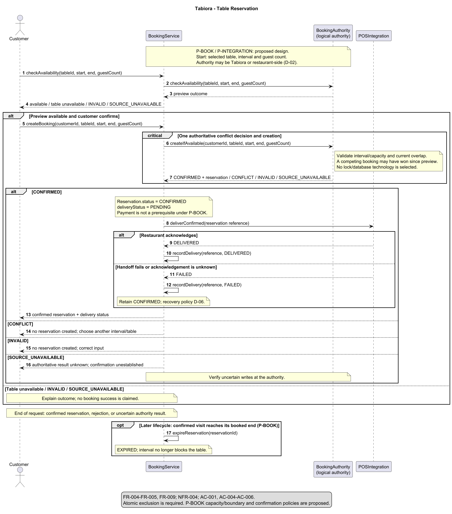
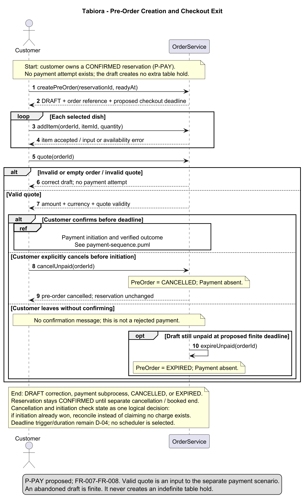
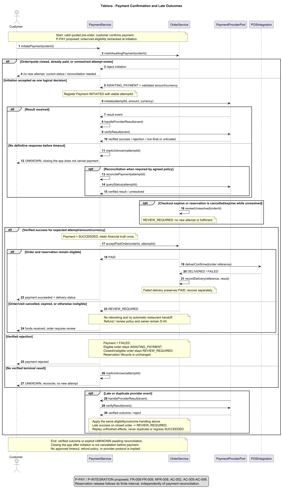
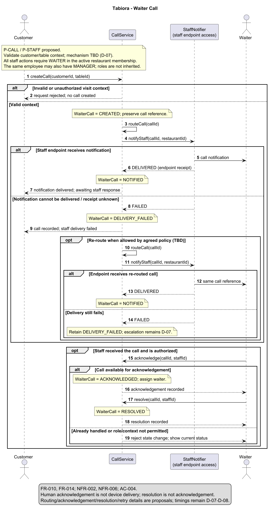

# Sequence Diagrams

**Proposed interactions** for booking, checkout, payment, and waiter calls.

## Design assumptions

The [baseline](architecture-baseline.md) defines invariants. See the [proposed lifecycle model](../requirements/functional-requirements.md#proposed-lifecycle-model) for states and the [permission matrix](../requirements/functional-requirements.md#proposed-staff-permissions) for staff roles.

## Table reservation

[PNG](../../assets/diagrams/booking-sequence/booking-sequence.png) · [PlantUML](../../assets/diagrams/booking-sequence/booking-sequence.puml)

**Start:** customer has selected table, interval and guest count. **End:** a confirmed finite reservation, `CONFLICT`, `INVALID`, or `SOURCE_UNAVAILABLE`. **Traceability:** UC-02, FR-004–FR-005, FR-009, NFR-004.

The preview is advisory. `BookingAuthority.createIfAvailable` decides and writes atomically across participating channels. `SOURCE_UNAVAILABLE` leaves confirmation unestablished. Verify any uncertain write at the authority, since a lost reply can follow a commit. See [ADR-001](adr/adr-001-authoritative-booking.md) for the outcome contract.

Failed handoff leaves the finite reservation intact. The booked end releases the interval. Cancellation follows the separate visit lifecycle under P-BOOK (D-03).

## Pre-order and payment

### Pre-order creation and checkout exit

[PNG](../../assets/diagrams/preorder-checkout-sequence/preorder-checkout-sequence.png) · [PlantUML](../../assets/diagrams/preorder-checkout-sequence/preorder-checkout-sequence.puml)

**Start:** customer owns a CONFIRMED reservation and has no payment attempt for this checkout. **End:** a draft needing correction, entry to the payment subprocess, CANCELLED, or EXPIRED. **Traceability:** UC-03, FR-007–FR-008; P-PAY.

OrderService creates DRAFT, accepts selected items/quantities, and validates a quote. A customer can then:

| Action before initiation | PreOrder | Payment | Reservation |
| --- | --- | --- | --- |
| Confirm a still-valid quote | Enter the separate payment subprocess | Attempt created only by that subprocess | Lifecycle unchanged |
| Explicitly cancel | CANCELLED | No attempt created | Not automatically cancelled |
| Leave without confirming | DRAFT, then EXPIRED at the proposed finite deadline | No attempt created | Not automatically cancelled; booked interval remains finite |

A draft adds no table hold. D-04 governs the proposed finite checkout deadline. Initiation and cancellation/expiry evaluate the same current state. Reconcile the existing attempt if initiation wins the race. [Checkout rules](../requirements/functional-requirements.md#checkout-exits-and-financial-consistency)

## Payment initiation and outcomes

[PNG](../../assets/diagrams/payment-sequence/payment-sequence.png) · [PlantUML](../../assets/diagrams/payment-sequence/payment-sequence.puml)

**Start:** customer confirms a valid quote. **End:** rejected initiation, a verified terminal financial result, or explicit UNKNOWN awaiting reconciliation/review. **Traceability:** UC-03, FR-008–FR-009, NFR-005/NFR-008; AC-002/AC-005/AC-006.

PaymentService rechecks order, quote, reservation and outstanding-attempt eligibility before registering an attempt. Closing the app after initiation does not cancel the provider's work.

| Event | Payment | PreOrder / resulting action |
| --- | --- | --- |
| Verified success while order/visit remains eligible | SUCCEEDED | PAID; hand off to restaurant and track acknowledgement separately |
| Verified rejection while eligible | FAILED | AWAITING_PAYMENT; permitted retry/cancellation/expiry policy applies |
| Timeout, untrusted or non-final result | UNKNOWN | AWAITING_PAYMENT while eligible; no fresh attempt, query/reconcile |
| Visit cancellation/expiry or checkout deadline while unresolved | Preserve INITIATED/UNKNOWN | REVIEW_REQUIRED; no new attempt or fulfilment |
| Verified late success after cancellation/expiry/ineligibility | SUCCEEDED | REVIEW_REQUIRED; no rebooking or automatic restaurant handoff |
| Verified late rejection for an ineligible order | FAILED | Retain REVIEW_REQUIRED pending agreed closure policy |
| Duplicate/out-of-order result | Apply verified new effects only; never regress SUCCEEDED | Resume unfinished work without duplicate orders/handoffs |

Callbacks and reconciliation use the same eligibility checks. If payment success was recorded before an interruption, recover order and handoff effects with the same attempt or business reference. D-04/D-05 govern review and refund rules. [ADR-002](adr/adr-002-verified-payment-and-restaurant-handoff.md)

FR-011 bill settlement is a separate flow. [UC-06](../requirements/use-cases.md#uc-06--pay-the-restaurant-bill)

## Waiter call

[PNG](../../assets/diagrams/waiter-call-sequence/waiter-call-sequence.png) · [PlantUML](../../assets/diagrams/waiter-call-sequence/waiter-call-sequence.puml)

**Start:** customer requests service in a validated restaurant/table context. **End:** rejected context, explicit delivery failure, or a retained call progressing through staff acknowledgement/resolution. **Traceability:** UC-04, FR-010/FR-014, NFR-002/NFR-006.

CallService routes through StaffNotifier. Endpoint receipt gives `NOTIFIED`. Staff with the WAITER role in the active restaurant can record `ACKNOWLEDGED` and `RESOLVED`. Failed or unknown receipt leaves `DELIVERY_FAILED`. Any reroute retains the call reference. Context, timing, and no-response escalation remain open under D-07/D-08. [Staff permissions](../requirements/functional-requirements.md#proposed-staff-permissions)

## Consistency and source coverage

Messages use the operations in the [class models](class-diagram.md). Sequence fragments show branches and repetition. Log important transitions under NFR-008.

[Use cases](../requirements/use-cases.md) · [Editable sources and exports](../../assets/diagrams/README.md#files) · [Architecture index](README.md)
